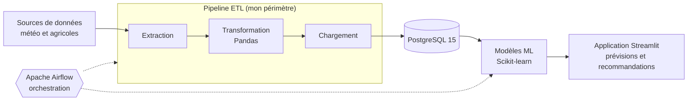

# Plateforme intelligente Météo & Agricole

> Une plateforme d'aide à la décision pour les agriculteurs africains : des données météo collectées automatiquement, des modèles prédictifs et une interface simple pour savoir **quand semer, arroser et récolter**.


**Projet réalisé lors du DataBeez Hackathon, en équipe.**

## Le problème

L'agriculture en Afrique dépend fortement de la météo, mais les agriculteurs font face à :

- des **pluies imprévisibles**, qui compliquent la planification de l'irrigation ;
- des **sécheresses et chaleurs extrêmes**, qui détruisent des récoltes ;
- un **manque d'informations fiables** en temps réel, souvent trop générales ou difficiles d'accès.

## La solution

Une plateforme de bout en bout qui :

1. fournit des **prévisions météo locales**, adaptées aux champs ;
2. s'appuie sur des **modèles prédictifs** (pluie, sécheresse, irrigation, maladies) ;
3. présente le tout dans une **interface Streamlit** accessible, avec des recommandations concrètes.

**But final :** mieux planifier semis, arrosage et récolte pour améliorer le rendement et réduire les pertes.

## Mon rôle : Data Engineer

J'étais responsable de la **chaîne de données** qui alimente toute la plateforme :

- **Pipeline ETL** : extraction automatique des données météo et agricoles, nettoyage et transformation avec Pandas, chargement dans PostgreSQL (dossier `etl/`).
- **Orchestration avec Apache Airflow** : conception des DAGs qui enchaînent extraction, transformation, chargement et entraînement des modèles, de façon planifiée et reproductible (dossier `dags/`).
- **Fiabilité des données** : des données propres et à jour, condition nécessaire pour que les modèles de machine learning et l'application restent pertinents.

## Architecture



## Fonctionnalités

- Extraction automatique des données météo et agricoles
- Prédictions par machine learning : pluie, sécheresse, irrigation, maladies
- Entraînement automatique des modèles si aucun n'est disponible
- Application Streamlit pour visualiser prévisions et recommandations
- Pipelines entièrement orchestrés par Airflow
- Déploiement de toute la stack en une commande avec Docker Compose

## Démarrage rapide

```bash
git clone <lien_du_repo>
cd Project
docker-compose up --build
```

| Service | URL | Identifiants (démo locale) |
|---|---|---|
| Application Streamlit | http://localhost:8501 | |
| Airflow | http://localhost:8080 | admin / admin |
| PgAdmin | http://localhost:5050 | admin@admin.com / admin |

## Structure du projet

```
Project/
├─ config/            # paramètres de configuration
├─ dags/              # DAGs Airflow (orchestration)
├─ data/              # données brutes et transformées
├─ etl/               # scripts d'extraction, transformation, chargement
├─ models/            # modèles de machine learning
├─ logs/              # journaux d'exécution
├─ demo/              # vidéo de démonstration
├─ Presentation/      # présentation du projet
├─ Team_CV/           # CVs de l'équipe
├─ docker-compose.yml # orchestration des services Docker
└─ requirements.txt   # dépendances Python
```

## Stack technique

`Python` · `Pandas` · `Scikit-learn` · `Apache Airflow` · `PostgreSQL` · `Streamlit` · `Docker` · `Docker Compose` · `ETL` · `Orchestration de pipelines`

## Ce que ce projet m'a appris

- Concevoir un pipeline de données **fiable et automatisé**, de la collecte à la mise à disposition.
- Orchestrer des tâches dépendantes avec **Airflow** (planification, reprise sur erreur, suivi des exécutions).
- Livrer un produit complet en **équipe et sous contrainte de temps**, en coordination avec les profils data science et applicatif.

## Équipe

Projet collectif du DataBeez Hackathon. Les CVs des membres sont dans `Team_CV/`.
